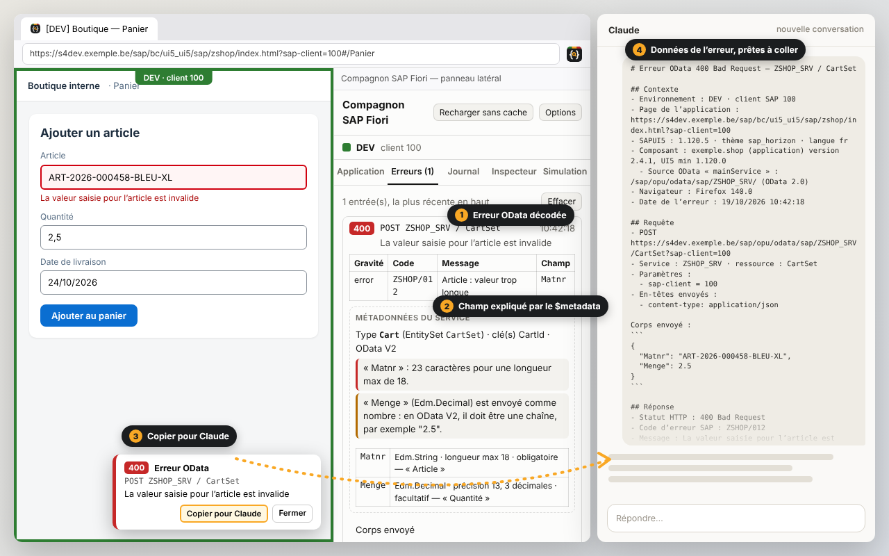

<p align="center">
  
</p>

<h1 align="center">Compagnon SAP Fiori / BTP</h1>

<p align="center">
  <a href="README.md">English</a> · <b>Français</b>
</p>

<p align="center">
  Extension Firefox et Chrome / Edge pour tester et déboguer les applications SAPUI5 / Fiori / BTP :<br>
  environnement visible, erreurs OData décodées, journal, inspecteur de contrôles, comparateur de versions.
</p>

<p align="center">
  <a href="https://github.com/Elyass12i/SAP-Fiori_compagnon/raw/main/installer-firefox/compagnon-sap-fiori.xpi"><b>⬇ Firefox (compagnon-sap-fiori.xpi)</b></a>
  &nbsp;·&nbsp; <a href="https://github.com/Elyass12i/SAP-Fiori_compagnon/raw/main/installer-chrome/compagnon-sap-fiori-chrome.zip"><b>⬇ Chrome / Edge (compagnon-sap-fiori-chrome.zip)</b></a><br>
  version 1.6.0 &nbsp;·&nbsp; Firefox 128+ · Chrome 116+ · Edge 116+
</p>



## Ce que fait l’extension

| | |
|---|---|
| **Bandeau d’environnement** | Cadre de couleur DEV / ACC / PROD et préfixe `[PROD]` dans le titre de l’onglet. |
| **Erreurs OData décodées** | Code et message SAP, détails par champ, ID de transaction, sous-requêtes de `$batch`. Notification dans la page et badge sur l’icône. |
| **Explication par le `$metadata`** | Type, longueur max, obligatoire… du champ en cause, et contrôle des valeurs envoyées. |
| **Copier pour Claude** | Toutes les données de l’erreur (contexte, requête, réponse, métadonnées), prêtes à coller dans une IA. Jamais de cookie ni de jeton. |
| **Journal OData** | Toutes les requêtes de l’onglet : durée, statut, paramètres, Rejouer, Copier en curl, export (Markdown / JSON). |
| **Détail des `$batch`** | Chaque sous-requête avec son corps envoyé, sa réponse et l’erreur SAP décodée ; changesets indiqués. |
| **Inspecteur de contrôles** | Alt+clic sur un élément : contrôle, vue, contrôleur, bindings et valeurs du modèle. |
| **Fiche et performances** | Version UI5, composants, cache du `manifest.json`, temps de chargement, éléments les plus lents. |
| **Comparateur d’environnements** | Versions de l’application et d’UI5 sur DEV, ACC et PROD côte à côte. |
| **Ouvrir dans DEV / ACC / PROD** | La même page (chemin, navigation `#`) sur un autre environnement, en un clic. |
| **Journaux SAP** | Depuis une erreur, ouvrir `/IWFND/ERROR_LOG` ou `/IWBEP/ERROR_LOG` dans SAP GUI pour HTML (ID de transaction copié). |
| **Textes i18n manquants** | Textes liés dont la clé i18n n’existe pas, et liaisons `{i18n>…}` restées en texte brut. |
| **Utilisateur connecté** | Utilisateur du launchpad et, à la demande, utilisateur BTP (application router) et utilisateur SAP du backend. |
| **Simulation d’erreurs** (développement uniquement) | Faire répondre une requête OData choisie par une erreur HTTP, une erreur réseau ou un délai, pour tester la gestion d’erreurs de l’application. Autorisée seulement sur les environnements cochés « Sim. », signalée par un bandeau rouge, coupée au démarrage de Firefox. |

L’interface est en anglais par défaut ; le français se choisit dans les options (**Interface language** / **Langue de l’interface**).
Tout est traité dans votre navigateur : aucune donnée n’est envoyée ailleurs.

## Installation dans Firefox

### 1. Fichier direct (le plus simple)
1. Cliquez sur **[⬇ compagnon-sap-fiori.xpi](https://github.com/Elyass12i/SAP-Fiori_compagnon/raw/main/installer-firefox/compagnon-sap-fiori.xpi)** : le téléchargement démarre directement.
2. Dans Firefox, ouvrez `about:debugging#/runtime/this-firefox`.
3. Cliquez **« Charger un module complémentaire temporaire… »** et choisissez le fichier téléchargé.

> Le paquet n’est pas encore signé par Mozilla : cette installation est **temporaire** et disparaît au redémarrage de Firefox. Une fois le paquet signé (voir 3), il suffira de **glisser le fichier dans une fenêtre Firefox** pour une installation permanente.

### 2. Une commande depuis le dépôt (Windows, PowerShell)
```powershell
git clone https://github.com/Elyass12i/SAP-Fiori_compagnon.git
cd SAP-Fiori_compagnon
powershell -ExecutionPolicy Bypass -File .\installer-firefox\install.ps1 -Pull
```
Le script récupère la dernière version et détecte si le paquet est signé :
- **signé** : Firefox affiche directement la demande d’installation (permanente) ;
- **non signé** : `about:debugging` s’ouvre et le chemin du fichier est copié ; collez-le dans la fenêtre « Charger un module complémentaire temporaire… ».

Pour **mettre à jour**, relancez la dernière commande.

### 3. Installation permanente (signature gratuite par Mozilla)
Firefox standard n’installe durablement que des extensions signées par Mozilla. La signature « non listée » est gratuite et ne publie rien :
- **automatique** : ajoutez les secrets `AMO_JWT_ISSUER` et `AMO_JWT_SECRET` au dépôt GitHub ; chaque nouvelle version est signée et le fichier `compagnon-sap-fiori.xpi` est remplacé par la version signée ;
- **depuis votre PC** : `powershell -ExecutionPolicy Bypass -File .\installer-firefox\sign.ps1 -ApiKey "…" -ApiSecret "…"`.

Détails : [firefox-sap-compagnon/README.fr.md](firefox-sap-compagnon/README.fr.md).

## Installation dans Chrome ou Edge

### 1. Fichier direct
1. Téléchargez **[⬇ compagnon-sap-fiori-chrome.zip](https://github.com/Elyass12i/SAP-Fiori_compagnon/raw/main/installer-chrome/compagnon-sap-fiori-chrome.zip)** et décompressez-le dans un dossier que vous gardez (ex. `Documents\CompagnonSAPFiori`).
2. Ouvrez `chrome://extensions` (Edge : `edge://extensions`) et activez le **mode développeur**.
3. Cliquez **« Charger l’extension non empaquetée »** et choisissez le dossier décompressé.

L’installation est permanente. Pour **mettre à jour**, décompressez la nouvelle version dans le même dossier, puis cliquez la flèche de rechargement sur la carte de l’extension : les réglages sont conservés.

### 2. Une commande depuis le dépôt (Windows, PowerShell)
```powershell
git clone https://github.com/Elyass12i/SAP-Fiori_compagnon.git
cd SAP-Fiori_compagnon
powershell -ExecutionPolicy Bypass -File .\installer-chrome\install-chrome.ps1 -Pull
```
Le script décompresse le paquet dans `%LOCALAPPDATA%\CompagnonSAPFiori\chrome`, copie ce chemin et ouvre `chrome://extensions` (ajoutez `-Browser Edge` pour Edge). La première fois : **mode développeur** → **Charger l’extension non empaquetée** → collez le chemin. Pour mettre à jour : relancez la commande, puis cliquez la flèche de rechargement de l’extension.

> Sans le mode développeur, Chrome et Edge n’installent que des extensions de leurs boutiques (Chrome Web Store : 5 USD une fois pour le compte développeur ; Microsoft Edge Add-ons : gratuit). Le même paquet peut y être soumis.

Différences avec Firefox : les requêtes OData sont observées dans la page (Chrome ne permet pas aux extensions de lire le corps des réponses), le panneau latéral est celui de Chrome, et le raccourci **Alt+Maj+O** l’ouvre. Tout le reste est identique.

## Premier réglage
À l’installation, la page d’options s’ouvre : ajoutez **+ DEV / + ACC / + PROD**, indiquez pour chacun un morceau de l’URL de votre système (et son URL système, utilisée par le comparateur, « Ouvrir dans » et les liens vers les journaux SAP), choisissez la langue de l’interface, puis **Save** (**Enregistrer** en français).
Raccourcis : **Alt+Maj+O** ouvre le panneau latéral, **Alt+clic** inspecte un contrôle.

## Contenu du dépôt

| Dossier | Contenu |
|---|---|
| [`firefox-sap-compagnon/`](firefox-sap-compagnon/) | Code source de l’extension, commun à Firefox et Chrome (JavaScript, HTML, CSS, sans framework). |
| [`chrome/`](chrome/) | Manifeste et script de construction Chrome / Edge (`node chrome/build.js`). |
| [`installer-firefox/`](installer-firefox/) | Paquet Firefox, scripts d’installation et de signature, logos, captures, textes de soumission. |
| [`installer-chrome/`](installer-chrome/) | Paquet Chrome / Edge et script d’installation. |

<sub>Extension indépendante, non affiliée à SAP SE. SAP, SAPUI5 et Fiori sont des marques de SAP SE.</sub>
