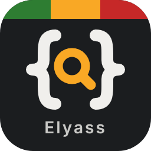
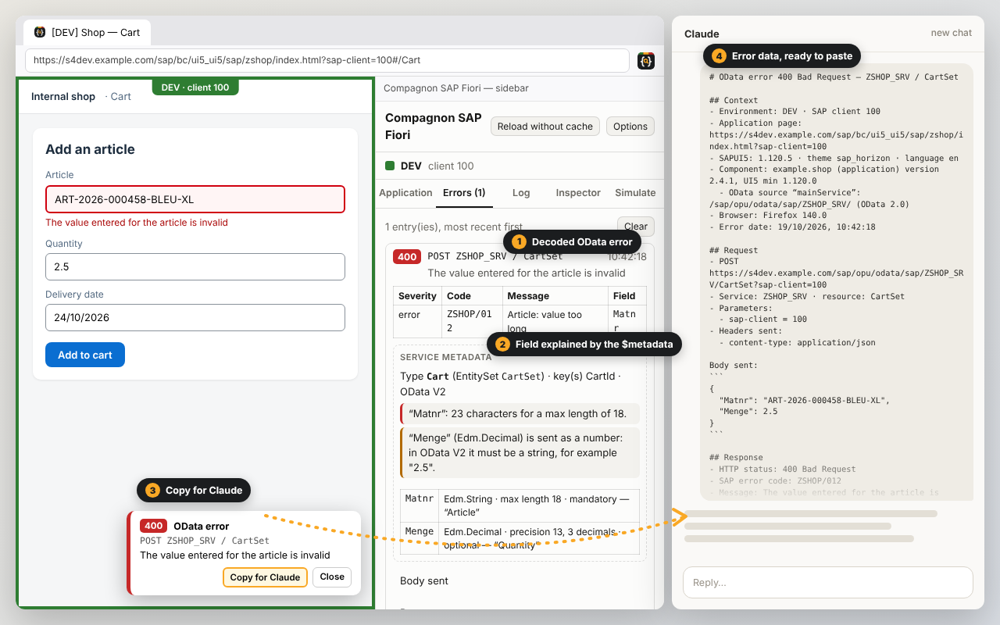

<p align="center">
  
</p>

<h1 align="center">Compagnon SAP Fiori / BTP</h1>

<p align="center">
  <b>English</b> · <a href="README.fr.md">Français</a>
</p>

<p align="center">
  Firefox and Chrome / Edge extension to test and debug SAPUI5 / Fiori / BTP applications:<br>
  visible environment, decoded OData errors, request log, control inspector, version comparison.
</p>

<p align="center">
  <a href="https://github.com/Elyass12i/SAP-Fiori_compagnon/raw/main/installer-firefox/compagnon-sap-fiori.xpi"><b>⬇ Firefox (compagnon-sap-fiori.xpi)</b></a>
  &nbsp;·&nbsp; <a href="https://github.com/Elyass12i/SAP-Fiori_compagnon/raw/main/installer-chrome/compagnon-sap-fiori-chrome.zip"><b>⬇ Chrome / Edge (compagnon-sap-fiori-chrome.zip)</b></a><br>
  version 1.6.0 &nbsp;·&nbsp; Firefox 128+ · Chrome 116+ · Edge 116+
</p>



## What the extension does

| | |
|---|---|
| **Environment banner** | DEV / ACC / PROD colour frame and a `[PROD]` prefix in the tab title. |
| **Decoded OData errors** | SAP code and message, per-field details, transaction ID, `$batch` sub-requests. Notification in the page and badge on the icon. |
| **Explained by the `$metadata`** | Type, max length, mandatory flag… of the field at fault, and a check of the values sent. |
| **Copy for Claude** | All the error data (context, request, response, metadata), ready to paste into an AI. Never any cookie or token. |
| **OData log** | Every request of the tab: duration, status, parameters, Replay, Copy as curl, export (Markdown / JSON). |
| **`$batch` details** | Each sub-request with its body sent, its response and the decoded SAP error; changesets shown. |
| **Control inspector** | Alt+click on an element: control, view, controller, bindings and model values. |
| **App sheet and performance** | UI5 version, components, `manifest.json` caching, load times, slowest resources. |
| **Environment comparison** | App and UI5 versions on DEV, ACC and PROD side by side. |
| **Open in DEV / ACC / PROD** | The same page (path, `#` navigation) on another environment, in one click. |
| **SAP logs** | From an error, open `/IWFND/ERROR_LOG` or `/IWBEP/ERROR_LOG` in SAP GUI for HTML (transaction ID copied). |
| **Missing i18n texts** | Bound texts whose i18n key does not exist, and `{i18n>…}` bindings left as raw text. |
| **Signed-in user** | Launchpad user and, on request, the BTP user (application router) and the SAP backend user. |
| **Error simulation** (development only) | Make a chosen OData request return an HTTP error, a network error or a delay, to test the app’s error handling. Allowed only on environments ticked “Sim.”, signalled by a red banner, switched off when Firefox starts. |

The interface is in English by default; French is available in the options (**Interface language**).
Everything is processed in your browser: no data is sent anywhere else.

## Installation in Firefox

### 1. Direct file (simplest)
1. Click **[⬇ compagnon-sap-fiori.xpi](https://github.com/Elyass12i/SAP-Fiori_compagnon/raw/main/installer-firefox/compagnon-sap-fiori.xpi)**: the download starts immediately.
2. In Firefox, open `about:debugging#/runtime/this-firefox`.
3. Click **“Load Temporary Add-on…”** and select the downloaded file.

> The package is not signed by Mozilla yet: this installation is **temporary** and disappears when Firefox restarts. Once the package is signed (see 3), simply **drag the file onto a Firefox window** for a permanent installation.

### 2. One command from the repository (Windows, PowerShell)
```powershell
git clone https://github.com/Elyass12i/SAP-Fiori_compagnon.git
cd SAP-Fiori_compagnon
powershell -ExecutionPolicy Bypass -File .\installer-firefox\install.ps1 -Pull
```
The script fetches the latest version and detects whether the package is signed:
- **signed**: Firefox shows the installation prompt directly (permanent);
- **unsigned**: `about:debugging` opens and the file path is copied; paste it in the “Load Temporary Add-on…” dialog.

To **update**, run the last command again.

### 3. Permanent installation (free signing by Mozilla)
Standard Firefox only keeps extensions signed by Mozilla. “Unlisted” signing is free and publishes nothing:
- **automatic**: add the `AMO_JWT_ISSUER` and `AMO_JWT_SECRET` secrets to the GitHub repository; every new version is signed and `compagnon-sap-fiori.xpi` is replaced by the signed one;
- **from your PC**: `powershell -ExecutionPolicy Bypass -File .\installer-firefox\sign.ps1 -ApiKey "…" -ApiSecret "…"`.

Details: [firefox-sap-compagnon/README.md](firefox-sap-compagnon/README.md).

## Installation in Chrome or Edge

### 1. Direct file
1. Download **[⬇ compagnon-sap-fiori-chrome.zip](https://github.com/Elyass12i/SAP-Fiori_compagnon/raw/main/installer-chrome/compagnon-sap-fiori-chrome.zip)** and extract it into a folder you keep (e.g. `Documents\CompagnonSAPFiori`).
2. Open `chrome://extensions` (Edge: `edge://extensions`) and enable **Developer mode**.
3. Click **“Load unpacked”** and select the extracted folder.

The installation is permanent. To **update**, extract the new version into the same folder, then click the reload arrow on the extension’s card: the settings are kept.

### 2. One command from the repository (Windows, PowerShell)
```powershell
git clone https://github.com/Elyass12i/SAP-Fiori_compagnon.git
cd SAP-Fiori_compagnon
powershell -ExecutionPolicy Bypass -File .\installer-chrome\install-chrome.ps1 -Pull
```
The script extracts the package into `%LOCALAPPDATA%\CompagnonSAPFiori\chrome`, copies that path and opens `chrome://extensions` (add `-Browser Edge` for Edge). First time: **Developer mode** → **Load unpacked** → paste the path. To update: run the command again, then click the extension’s reload arrow.

> Without “Developer mode”, Chrome and Edge only install extensions from their stores (Chrome Web Store: one-time 5 USD developer fee; Microsoft Edge Add-ons: free). The same package can be submitted there.

Differences from Firefox: OData requests are observed inside the page (Chrome does not let extensions read response bodies), the sidebar is Chrome’s side panel, and the shortcut **Alt+Shift+O** opens it. Everything else is identical.

## First setup
On installation, the options page opens: add **+ DEV / + ACC / + PROD**, enter for each one a part of your system’s URL (and its system URL, used by the comparison, “Open in” and the SAP log links), choose the interface language, then click **Save**.
Shortcuts: **Alt+Shift+O** opens the sidebar, **Alt+click** inspects a control.

## Repository contents

| Folder | Contents |
|---|---|
| [`firefox-sap-compagnon/`](firefox-sap-compagnon/) | Extension source code, shared by Firefox and Chrome (JavaScript, HTML, CSS, no framework). |
| [`chrome/`](chrome/) | Chrome / Edge manifest and build script (`node chrome/build.js`). |
| [`installer-firefox/`](installer-firefox/) | Firefox package, install and signing scripts, logos, screenshots, submission texts. |
| [`installer-chrome/`](installer-chrome/) | Chrome / Edge package and install script. |

<sub>Independent extension, not affiliated with SAP SE. SAP, SAPUI5 and Fiori are trademarks of SAP SE.</sub>
